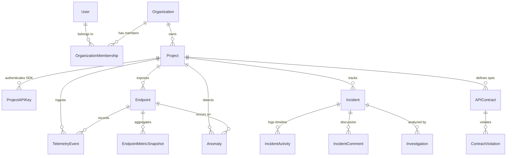

# CrimsonPulse AI — Backend-to-Frontend Integration Plan & Architecture Contract

> **Document Version**: 1.0.0  
> **Target System**: CrimsonPulse AI (AI-Powered API Intelligence & Incident Management Platform)  
> **Status**: Official Integration Contract & Specification  
> **Author**: Lead Backend Architect & Full-Stack Engineer  

---

## 1. Executive Summary & Purpose

This integration plan defines the complete contract between the existing React + TypeScript frontend (`frontend/`) and the Django REST Framework backend (`backend/`).

### Core Principles
1. **Zero Frontend Redesign**: The existing frontend styling, black and charcoal `#090A0D` theme, crimson red `#E63946` accents, navigation, and components are preserved without alteration.
2. **Contract-Driven Compatibility**: Backend endpoints and JSON payloads are tailored to match existing TypeScript interfaces in `frontend/src/types/index.ts` and service patterns in `frontend/src/services/`.
3. **Multi-Tenant SaaS Isolation**: Every query and mutation is strictly scoped to the authenticated user's organization and project membership.
4. **Honest Architectural Boundaries**:
   - Rule-based anomaly detection operates deterministically with transparent thresholds; ML-based detection is defined via modular service interfaces for subsequent phases.
   - AI Investigator presents real telemetry and incident evidence without fabricated LLM output.
   - Project API keys use secure cryptographically hashed storage (`Argon2` / `PBKDF2` / SHA-256) and are displayed only once upon creation.

---

## 2. Comprehensive Page-by-Page Integration Matrix

| # | Page Route | Primary Frontend Component | Data Required by Page | Target Backend Endpoint | Supporting Database Models | Frontend Mutations (POST/PATCH/DELETE) | ML/LLM Gated Features |
|---|---|---|---|---|---|---|---|
| 1 | `/` & `/landing` | `LandingPage.tsx` | Static marketing content, feature highlights, architecture showcase | None (Static) | None | None | None |
| 2 | `/login` | `LoginPage.tsx` | User credentials (`email`, `password`) | `POST /api/v1/auth/login/` | `User`, `OrganizationMembership` | `POST /api/v1/auth/login/` | None |
| 3 | `/register` | `RegisterPage.tsx` | New account input (`name`, `email`, `password`, `organizationName`) | `POST /api/v1/auth/register/` | `User`, `Organization`, `OrganizationMembership` | `POST /api/v1/auth/register/` | None |
| 4 | `/dashboard` | `DashboardPage.tsx` | Aggregated KPIs (Total Requests, Error Rate %, P95 Latency ms, Open Incidents count), 24h traffic timeseries, Endpoint health table (top degraded endpoints), Active AI Signal, Recent incidents | `GET /api/v1/projects/{project_id}/dashboard/` (or global `/api/v1/overview/`) | `TelemetryEvent`, `EndpointMetricSnapshot`, `Endpoint`, `Incident`, `Anomaly` | None (Read-only dashboard view) | Future: Automated LLM synthesis of the active AI Signal card |
| 5 | `/projects` | `ProjectsPage.tsx` | List of accessible projects, health status, total requests, error rates, endpoint counts | `GET /api/v1/projects/` | `Project`, `Endpoint`, `TelemetryEvent` | `POST /api/v1/projects/` (Create), `DELETE /api/v1/projects/{id}/` | None |
| 6 | `/projects/:id` | `ProjectDetailsPage.tsx` | Project metadata, environment, API key view (masked), 24h metrics, filtered endpoint list, project incidents | `GET /api/v1/projects/{id}/`<br>`GET /api/v1/projects/{id}/metrics/timeseries/`<br>`GET /api/v1/projects/{id}/endpoints/`<br>`GET /api/v1/projects/{id}/incidents/` | `Project`, `ProjectAPIKey`, `Endpoint`, `Incident`, `EndpointMetricSnapshot` | `PATCH /api/v1/projects/{id}/` (Settings), `DELETE /api/v1/projects/{id}/` | None |
| 7 | `/explorer` & `/api-explorer` | `APIExplorerPage.tsx` | Discovered endpoints list, method, path, requestCount, avgLatency, p95Latency, errorRate, health, status distribution | `GET /api/v1/projects/{project_id}/endpoints/` | `Endpoint`, `EndpointMetricSnapshot` | None (Discovery is driven by ingestion/contract import) | None |
| 8 | `/explorer/:id` & `/api-explorer/:id` | `EndpointDetailsPage.tsx` | Endpoint metadata, latency percentiles, status distribution (2xx-5xx), 24h hourly metric windows, related anomalies, related contract violations | `GET /api/v1/projects/{project_id}/endpoints/{id}/`<br>`GET /api/v1/projects/{project_id}/endpoints/{id}/metrics/`<br>`GET /api/v1/projects/{project_id}/endpoints/{id}/traffic/` | `Endpoint`, `EndpointMetricSnapshot`, `Anomaly`, `ContractViolation`, `TelemetryEvent` | None (Read-only investigation) | None |
| 9 | `/traffic` & `/live-traffic` | `LiveTrafficPage.tsx` | Live stream buffer of recent HTTP requests (method, route, status_code, latency_ms, timestamp, environment, appVersion, error) | `GET /api/v1/projects/{project_id}/traffic/`<br>`GET /api/v1/projects/{project_id}/traffic/summary/` | `TelemetryEvent` | None (Periodic polling from frontend stream buffer) | None |
| 10 | `/anomalies` | `AnomaliesPage.tsx` | List of detected anomalies, severity (`critical`, `high`, `medium`, `low`), metric name, baseline vs observed value, anomaly score, status, detection method | `GET /api/v1/projects/{project_id}/anomalies/` | `Anomaly`, `Endpoint` | `PATCH /api/v1/projects/{project_id}/anomalies/{id}/` (Status toggle) | Rule-based engine active now; Scikit-learn Isolation Forest extension point ready |
| 11 | `/anomalies/:id` | `AnomalyDetailsPage.tsx` | Detailed anomaly metrics, baseline vs observed delta, model version/rule label, status update controls, related incident link, supporting telemetry | `GET /api/v1/projects/{project_id}/anomalies/{id}/` | `Anomaly`, `Endpoint`, `TelemetryEvent`, `Incident` | `PATCH /api/v1/projects/{project_id}/anomalies/{id}/` | Future ML score explanation |
| 12 | `/incidents` | `IncidentsPage.tsx` | Incident list, severity, status (`open`, `acknowledged`, `investigating`, `resolved`), endpoint, occurrence count, first detected, last occurred, assignee | `GET /api/v1/projects/{project_id}/incidents/` | `Incident`, `IncidentActivity`, `Anomaly`, `User` | None | None |
| 13 | `/incidents/:id` | `IncidentDetailsPage.tsx` | Incident detail, status controls, assignee, AI summary text, performance evidence chart, deployment correlation (commit, author, version), timeline events, comments | `GET /api/v1/projects/{project_id}/incidents/{id}/`<br>`GET /api/v1/projects/{project_id}/incidents/{id}/timeline/`<br>`GET /api/v1/projects/{project_id}/incidents/{id}/comments/` | `Incident`, `IncidentActivity`, `IncidentComment`, `DeploymentInfo` | `PATCH /api/v1/projects/{project_id}/incidents/{id}/`<br>`POST /api/v1/projects/{project_id}/incidents/{id}/comments/` | Automated LLM incident summary generation |
| 14 | `/contracts` | `ContractsPage.tsx` | Uploaded OpenAPI specs list, spec version, endpoint count, validation status (`valid`, `violations_found`), violations list (type, field, expected, observed) | `GET /api/v1/projects/{project_id}/contracts/`<br>`GET /api/v1/projects/{project_id}/contracts/violations/`<br>`POST /api/v1/projects/{project_id}/contracts/` | `APIContract`, `ContractViolation`, `Endpoint` | `POST /api/v1/projects/{project_id}/contracts/` (Upload spec), `DELETE /api/v1/projects/{project_id}/contracts/{id}/` | Full payload schema deep validation (when bodies collected) |
| 15 | `/investigator` & `/ai-investigator` | `AIInvestigatorPage.tsx` | Incident investigation thread, evidence cards (metric, log, deployment, trace, correlation), debug checklist items, contextual Q&A conversation | `GET /api/v1/projects/{project_id}/investigations/{incident_id}/`<br>`POST /api/v1/projects/{project_id}/investigations/{incident_id}/messages/`<br>`PATCH /api/v1/projects/{project_id}/investigations/{incident_id}/checklist/{item_id}/` | `Investigation`, `InvestigationMessage`, `EvidenceCard`, `DebugChecklistItem`, `Incident` | `POST .../messages/`, `PATCH .../checklist/{item_id}/` | Generative LLM reasoning (backend currently provides real telemetry evidence & deterministic reasoning engine v4.2) |
| 16 | `/integrations` | `IntegrationsPage.tsx` | Project API keys list (masked), SDK telemetry connection heartbeat status, SDK installation guide, destination settings (Slack, Webhooks) | `GET /api/v1/projects/{project_id}/api-keys/`<br>`POST /api/v1/projects/{project_id}/api-keys/`<br>`POST /api/v1/projects/{project_id}/api-keys/{id}/revoke/`<br>`GET /api/v1/projects/{project_id}/sdk/status/` | `ProjectAPIKey`, `Integration`, `TelemetryEvent` | `POST /api-keys/` (Generate), `POST /api-keys/{id}/revoke/`, `POST /api-keys/{id}/rotate/` | None |
| 17 | `/settings` | `SettingsPage.tsx` | User profile (name, email), Organization settings (name, retention, default env), Team members list, Notification toggles, Alert threshold settings | `GET /api/v1/auth/me/`<br>`PATCH /api/v1/auth/me/`<br>`GET /api/v1/organizations/current/`<br>`PATCH /api/v1/organizations/current/`<br>`GET /api/v1/organizations/current/members/`<br>`POST /api/v1/organizations/current/invitations/`<br>`GET /api/v1/projects/{project_id}/settings/`<br>`PATCH /api/v1/projects/{project_id}/settings/` | `User`, `Organization`, `OrganizationMembership`, `ProjectSettings`, `AlertThreshold` | `PATCH /api/v1/auth/me/`, `PATCH /organizations/current/`, `POST /invitations/`, `PATCH /projects/{id}/settings/` | None |

---

## 3. Database Models & Schema Design (PostgreSQL)



### Core Entities & Field Specifications

#### 1. `User` (`apps.accounts.models.User`)
* Extends `AbstractBaseUser`, `PermissionsMixin`.
* Primary key: `id` (UUIDv4).
* `email`: `EmailField(unique=True, db_index=True)`.
* `name`: `CharField(max_length=255)`.
* `role`: Default role in platform (`owner`, `admin`, `developer`, `viewer`).
* `is_active`: `BooleanField(default=True)`.
* `is_staff`: `BooleanField(default=False)`.
* `date_joined`: `DateTimeField(auto_now_add=True)`.
* `updated_at`: `DateTimeField(auto_now=True)`.

#### 2. `Organization` (`apps.organizations.models.Organization`)
* `id`: UUIDv4.
* `name`: `CharField(max_length=255)`.
* `slug`: `SlugField(unique=True, db_index=True)`.
* `plan`: `CharField(choices=['free', 'pro', 'enterprise'], default='pro')`.
* `retention_days`: `PositiveIntegerField(default=30)`.
* `created_by`: `ForeignKey(User, on_delete=SET_NULL, null=True)`.
* `created_at`: `DateTimeField(auto_now_add=True)`.

#### 3. `OrganizationMembership` (`apps.organizations.models.OrganizationMembership`)
* `id`: UUIDv4.
* `organization`: `ForeignKey(Organization, on_delete=CASCADE, related_name='memberships')`.
* `user`: `ForeignKey(User, on_delete=CASCADE, related_name='memberships')`.
* `role`: `CharField(choices=['owner', 'admin', 'developer', 'viewer'], default='developer')`.
* `joined_at`: `DateTimeField(auto_now_add=True)`.
* Unique constraint: `('organization', 'user')`.

#### 4. `Project` (`apps.projects.models.Project`)
* `id`: `CharField(max_length=64, primary_key=True)` (e.g. `proj_01` or UUIDv4).
* `organization`: `ForeignKey(Organization, on_delete=CASCADE, related_name='projects')`.
* `name`: `CharField(max_length=255)`.
* `slug`: `SlugField(max_length=255, db_index=True)`.
* `description`: `TextField(blank=True)`.
* `environment`: `CharField(choices=['development', 'staging', 'production'], default='production')`.
* `base_url`: `URLField(max_length=512)`.
* `health`: `CharField(choices=['healthy', 'degraded', 'critical', 'unknown'], default='healthy')`.
* `created_at`: `DateTimeField(auto_now_add=True)`.
* `updated_at`: `DateTimeField(auto_now=True)`.
* Unique constraint: `('organization', 'slug', 'environment')`.

#### 5. `ProjectAPIKey` (`apps.projects.models.ProjectAPIKey`)
* `id`: `CharField(max_length=64, primary_key=True)` (e.g. `key_01`).
* `project`: `ForeignKey(Project, on_delete=CASCADE, related_name='api_keys')`.
* `name`: `CharField(max_length=255)`.
* `key_prefix`: `CharField(max_length=16)` (e.g. `cpk_live_`).
* `key_hash`: `CharField(max_length=255, db_index=True)` (Argon2 / SHA-256 hash of secret token).
* `masked_key`: `CharField(max_length=32)` (e.g. `cpk_live_****7e91`).
* `status`: `CharField(choices=['active', 'revoked'], default='active')`.
* `last_used_at`: `DateTimeField(null=True, blank=True)`.
* `created_at`: `DateTimeField(auto_now_add=True)`.

#### 6. `Endpoint` (`apps.endpoints.models.Endpoint`)
* `id`: `CharField(max_length=64, primary_key=True)` (e.g. `ep_01` or UUIDv4).
* `project`: `ForeignKey(Project, on_delete=CASCADE, related_name='endpoints')`.
* `method`: `CharField(choices=['GET', 'POST', 'PUT', 'PATCH', 'DELETE'])`.
* `path`: `CharField(max_length=512, db_index=True)`.
* `normalized_path`: `CharField(max_length=512, db_index=True)`.
* `health`: `CharField(choices=['healthy', 'degraded', 'critical', 'unknown'], default='healthy')`.
* `first_seen_at`: `DateTimeField(auto_now_add=True)`.
* `last_seen_at`: `DateTimeField(auto_now=True)`.
* Unique constraint: `('project', 'method', 'normalized_path')`.

#### 7. `TelemetryEvent` (`apps.telemetry.models.TelemetryEvent`)
* `id`: `CharField(max_length=64, primary_key=True)` (e.g. `tel_01` or UUIDv4).
* `project`: `ForeignKey(Project, on_delete=CASCADE, related_name='telemetry_events')`.
* `endpoint`: `ForeignKey(Endpoint, on_delete=SET_NULL, null=True, related_name='events')`.
* `event_id`: `CharField(max_length=128, db_index=True, unique=True)`.
* `request_id`: `CharField(max_length=128, blank=True)`.
* `method`: `CharField(max_length=10)`.
* `path`: `CharField(max_length=512)`.
* `status_code`: `PositiveIntegerField(db_index=True)`.
* `response_time_ms`: `FloatField(db_index=True)`.
* `environment`: `CharField(max_length=32, db_index=True)`.
* `app_version`: `CharField(max_length=64, blank=True)`.
* `sdk_version`: `CharField(max_length=32, blank=True)`.
* `error`: `TextField(blank=True, null=True)`.
* `timestamp`: `DateTimeField(db_index=True)`.

#### 8. `EndpointMetricSnapshot` (`apps.metrics.models.EndpointMetricSnapshot`)
* `id`: UUIDv4.
* `project`: `ForeignKey(Project, on_delete=CASCADE)`.
* `endpoint`: `ForeignKey(Endpoint, on_delete=CASCADE, related_name='metric_snapshots', null=True)`.
* `window_start`: `DateTimeField(db_index=True)`.
* `window_duration_seconds`: `PositiveIntegerField(default=3600)`.
* `request_count`: `PositiveIntegerField(default=0)`.
* `success_count_2xx`: `PositiveIntegerField(default=0)`.
* `redirect_count_3xx`: `PositiveIntegerField(default=0)`.
* `client_error_count_4xx`: `PositiveIntegerField(default=0)`.
* `server_error_count_5xx`: `PositiveIntegerField(default=0)`.
* `error_rate`: `FloatField(default=0.0)`.
* `avg_latency`: `FloatField(default=0.0)`.
* `p50_latency`: `FloatField(default=0.0)`.
* `p95_latency`: `FloatField(default=0.0)`.
* `p99_latency`: `FloatField(default=0.0)`.
* `throughput_rps`: `FloatField(default=0.0)`.

#### 9. `Anomaly` (`apps.anomalies.models.Anomaly`)
* `id`: `CharField(max_length=64, primary_key=True)` (e.g. `anom_01`).
* `project`: `ForeignKey(Project, on_delete=CASCADE, related_name='anomalies')`.
* `endpoint`: `ForeignKey(Endpoint, on_delete=CASCADE, related_name='anomalies')`.
* `severity`: `CharField(choices=['critical', 'high', 'medium', 'low'])`.
* `metric`: `CharField(max_length=64)` (e.g. `p95_latency`, `error_rate`, `request_volume`).
* `baseline_value`: `FloatField()`.
* `observed_value`: `FloatField()`.
* `anomaly_score`: `FloatField()` (Normalized score between 0.00 and 1.00).
* `model_version`: `CharField(max_length=64, default='rule-detector-v1.0')`.
* `detection_method`: `CharField(choices=['rule_based', 'statistical_zscore', 'isolation_forest'], default='rule_based')`.
* `description`: `TextField()`.
* `status`: `CharField(choices=['active', 'acknowledged', 'resolved', 'false_positive'], default='active')`.
* `detected_at`: `DateTimeField(auto_now_add=True, db_index=True)`.
* `resolved_at`: `DateTimeField(null=True, blank=True)`.

#### 10. `Incident` (`apps.incidents.models.Incident`)
* `id`: `CharField(max_length=64, primary_key=True)` (e.g. `inc_01`).
* `project`: `ForeignKey(Project, on_delete=CASCADE, related_name='incidents')`.
* `title`: `CharField(max_length=255)`.
* `description`: `TextField()`.
* `severity`: `CharField(choices=['critical', 'high', 'medium', 'low'])`.
* `status`: `CharField(choices=['open', 'acknowledged', 'investigating', 'resolved'], default='open')`.
* `endpoint`: `CharField(max_length=512)`.
* `method`: `CharField(max_length=10)`.
* `occurrence_count`: `PositiveIntegerField(default=1)`.
* `first_detected`: `DateTimeField(auto_now_add=True)`.
* `last_occurred`: `DateTimeField(auto_now=True)`.
* `assignee`: `ForeignKey(User, on_delete=SET_NULL, null=True, blank=True)`.
* `related_anomalies`: `ManyToManyField(Anomaly, blank=True, related_name='incidents')`.
* `ai_summary`: `TextField(blank=True)`.
* `deployment_version`: `CharField(max_length=64, blank=True)`.
* `deployment_commit`: `CharField(max_length=64, blank=True)`.
* `deployment_author`: `CharField(max_length=255, blank=True)`.
* `deployment_changelog`: `TextField(blank=True)`.

#### 11. `IncidentActivity` & `IncidentComment` (`apps.incidents.models`)
* Track timeline updates (`status_change`, `assignment`, `anomaly_detected`, `comment`) and team notes with timestamps.

#### 12. `APIContract` & `ContractViolation` (`apps.contracts.models`)
* `APIContract`: Stores uploaded OpenAPI YAML/JSON, version, endpoint count, parsed spec JSON.
* `ContractViolation`: Tracks route mismatches, unexpected fields, type drift, and breaking schema changes.

#### 13. `Investigation` (`apps.ai_assistant.models`)
* Supports evidence snapshots (`EvidenceCard`), investigation messages (`AIMessage`), and interactive checklists (`DebugChecklistItem`).

---

## 4. API Endpoints Contract & JSON Specifications

All API routes are prefixed under `/api/v1/`.

### 4.1 Authentication & Profile APIs

#### `POST /api/v1/auth/register/`
* **Request**:
```json
{
  "name": "Alex Rivera",
  "email": "alex.rivera@crimsonpulse.io",
  "password": "SecurePassword123!",
  "organization_name": "CrimsonPulse Labs"
}
```
* **Response** (`201 Created`):
```json
{
  "user": {
    "id": "usr_01",
    "name": "Alex Rivera",
    "email": "alex.rivera@crimsonpulse.io",
    "role": "owner",
    "created_at": "2026-11-09T08:00:00Z"
  },
  "organization": {
    "id": "org_01",
    "name": "CrimsonPulse Labs",
    "slug": "crimsonpulse-labs",
    "plan": "pro"
  },
  "tokens": {
    "access": "eyJhbGciOi...",
    "refresh": "eyJhbGciOi..."
  }
}
```

#### `POST /api/v1/auth/login/`
* **Request**:
```json
{
  "email": "alex.rivera@crimsonpulse.io",
  "password": "SecurePassword123!"
}
```
* **Response** (`200 OK`):
```json
{
  "user": {
    "id": "usr_01",
    "name": "Alex Rivera",
    "email": "alex.rivera@crimsonpulse.io",
    "role": "owner",
    "created_at": "2026-11-09T08:00:00Z"
  },
  "tokens": {
    "access": "eyJhbGciOi...",
    "refresh": "eyJhbGciOi..."
  }
}
```

#### `GET /api/v1/auth/me/`
* **Headers**: `Authorization: Bearer <access_token>`
* **Response** (`200 OK`):
```json
{
  "id": "usr_01",
  "name": "Alex Rivera",
  "email": "alex.rivera@crimsonpulse.io",
  "avatar": null,
  "role": "owner",
  "created_at": "2026-05-13T08:00:00Z"
}
```

---

### 4.2 Telemetry Ingestion API (SDK Gateway)

#### `POST /api/v1/ingest/events/`
* **Headers**: `X-CrimsonPulse-Key: cpk_live_nxc_99214710`
* **Request**:
```json
{
  "sdk_version": "1.2.3",
  "events": [
    {
      "event_id": "evt_7f9a12c8-8921-4f30-8012-984218a00192",
      "request_id": "req_8812a",
      "method": "POST",
      "path": "/api/orders/",
      "status_code": 201,
      "latency_ms": 142.5,
      "environment": "production",
      "timestamp": "2026-11-09T08:45:00Z",
      "release_version": "2.4.1"
    }
  ]
}
```
* **Response** (`202 Accepted`):
```json
{
  "status": "accepted",
  "processed": 1,
  "accepted": 1,
  "rejected": 0,
  "duplicates": 0
}
```

---

### 4.3 Projects API

#### `GET /api/v1/projects/`
* **Response** (`200 OK`):
```json
[
  {
    "id": "proj_01",
    "name": "Nexus Commerce API",
    "slug": "nexus-commerce-api",
    "description": "Core e-commerce REST API powering product catalog, orders, and payment processing.",
    "environment": "production",
    "baseUrl": "https://api.nexuscommerce.io/v2",
    "endpointCount": 6,
    "totalRequests": 842500,
    "errorRate": 0.38,
    "health": "degraded",
    "apiKey": "cpk_live_nxc_****7e91",
    "createdAt": "2026-07-12T08:00:00Z",
    "updatedAt": "2026-11-09T06:00:00Z"
  }
]
```

---

### 4.4 Dashboard Overview API

#### `GET /api/v1/projects/{project_id}/dashboard/`
* **Query Parameters**: `?time_range=24h`
* **Response** (`200 OK`):
```json
{
  "kpis": {
    "total_requests": 842500,
    "formatted_total_requests": "842.5K",
    "request_change_pct": 12.5,
    "error_rate_pct": 0.38,
    "error_rate_change_pct": -0.08,
    "p95_latency_ms": 184,
    "p95_latency_change_ms": 2,
    "open_incidents_count": 3
  },
  "sparklines": {
    "requests": [38, 42, 45, 40, 48, 52, 58, 54, 62, 65, 68, 72],
    "error_rate": [0.55, 0.52, 0.48, 0.50, 0.46, 0.44, 0.42, 0.43, 0.41, 0.40, 0.42, 0.42],
    "latency": [178, 180, 182, 179, 185, 183, 188, 182, 184, 186, 183, 184]
  },
  "active_signal": {
    "id": "sig_01",
    "title": "Orders Latency Surge",
    "endpoint": "/api/orders/",
    "method": "POST",
    "severity": "critical",
    "baseline_p95": 180,
    "observed_p95": 2100,
    "baseline_error_rate": 0.40,
    "observed_error_rate": 1.82,
    "related_incident_id": "inc_01"
  },
  "traffic_timeseries": [
    {
      "timestamp": "2026-11-09T08:00:00Z",
      "requests": 35200,
      "p95Latency": 184,
      "p50Latency": 42,
      "errorRate": 0.38,
      "avgLatency": 56
    }
  ]
}
```

---

### 4.5 Endpoints API

#### `GET /api/v1/projects/{project_id}/endpoints/`
* **Query Parameters**: `?method=GET&health=degraded&search=products&sort_by=requestCount&sort_order=desc`
* **Response** (`200 OK`):
```json
[
  {
    "id": "ep_01",
    "projectId": "proj_01",
    "method": "GET",
    "path": "/api/products/",
    "requestCount": 312400,
    "avgLatency": 45,
    "p50Latency": 38,
    "p95Latency": 92,
    "p99Latency": 148,
    "errorRate": 0.12,
    "health": "healthy",
    "lastActivity": "2026-11-09T08:44:00Z",
    "statusDistribution": {
      "2xx": 96.2,
      "3xx": 2.8,
      "4xx": 0.8,
      "5xx": 0.2
    }
  }
]
```

---

### 4.6 Anomalies & Incidents API

#### `GET /api/v1/projects/{project_id}/anomalies/`
* **Query Parameters**: `?severity=critical&status=active`
* **Response** (`200 OK`):
```json
[
  {
    "id": "anom_01",
    "projectId": "proj_01",
    "endpointId": "ep_02",
    "endpoint": "/api/orders/",
    "method": "POST",
    "severity": "critical",
    "metric": "p95_latency",
    "baselineValue": 180,
    "observedValue": 2100,
    "anomalyScore": 0.94,
    "modelVersion": "rule-detector-v1.0",
    "description": "P95 latency for POST /api/orders/ increased from 180ms baseline to 2100ms (11.7x deviation).",
    "detectedAt": "2026-11-09T05:45:00Z",
    "status": "active",
    "relatedIncidentId": "inc_01"
  }
]
```

#### `GET /api/v1/projects/{project_id}/incidents/`
* **Response** (`200 OK`):
```json
[
  {
    "id": "inc_01",
    "projectId": "proj_01",
    "title": "Orders Latency Spike",
    "description": "POST /api/orders/ P95 latency surged from 180ms to 2100ms due to database worker queueing.",
    "severity": "critical",
    "status": "investigating",
    "endpoint": "/api/orders/",
    "method": "POST",
    "occurrenceCount": 1842,
    "firstDetected": "2026-11-09T05:45:00Z",
    "lastOccurred": "2026-11-09T08:44:00Z",
    "relatedAnomalyIds": ["anom_01", "anom_06"],
    "aiSummary": "Primary hypothesis: database connection pool saturation. Recommended: add composite index on inventory."
  }
]
```

#### `PATCH /api/v1/projects/{project_id}/incidents/{id}/`
* **Request**:
```json
{
  "status": "acknowledged"
}
```
* **Response** (`200 OK`): Updated incident record with new timeline event appended.

---

### 4.7 OpenAPI Contract Validation API

#### `POST /api/v1/projects/{project_id}/contracts/`
* **Content-Type**: `multipart/form-data` or `application/json`
* **Request**:
```json
{
  "name": "Nexus Commerce Storefront Spec",
  "version": "2.1.0",
  "content": "openapi: 3.0.3\ninfo:\n  title: Nexus API\n  version: 2.1.0..."
}
```
* **Response** (`201 Created`):
```json
{
  "id": "spec_01",
  "projectId": "proj_01",
  "name": "Nexus Commerce Storefront Spec",
  "version": "2.1.0",
  "uploadedAt": "2026-11-09T08:50:00Z",
  "endpointCount": 6,
  "status": "violations_found"
}
```

---

### 4.8 AI Investigator & Evidence API

#### `GET /api/v1/projects/{project_id}/investigations/{incident_id}/`
* **Response** (`200 OK`):
```json
{
  "id": "inv_01",
  "incidentId": "inc_01",
  "messages": [
    {
      "id": "msg_01",
      "role": "assistant",
      "content": "### 1. Observed Evidence (Verified Facts)\n- **Metric**: P95 latency surged from 180ms to 2,100ms...",
      "timestamp": "2026-11-09T06:00:00Z"
    }
  ],
  "evidenceCards": [
    {
      "id": "ev_01",
      "title": "Latency Spike Timeline",
      "type": "metric",
      "source": "Telemetry timeseries (POST /api/orders/ P95)",
      "verified": true,
      "content": "P95 latency surged from 180ms to 2100ms starting at deploy timestamp.",
      "severity": "critical"
    }
  ],
  "suggestedActions": [
    "Add composite index on inventory(product_id, updated_at)",
    "Expand connection pool max from 20 to 50"
  ],
  "debugChecklist": [
    {
      "id": "chk_01",
      "label": "Inspect PostgreSQL EXPLAIN ANALYZE on query",
      "completed": true,
      "priority": "high"
    }
  ]
}
```

---

## 5. Security Architecture & Threat Model

1. **Authentication Boundary**:
   - Web application users authenticate via short-lived JWT access tokens (15-minute TTL) and refresh tokens (7-day TTL).
   - Monitored applications authenticate exclusively via high-entropy Project API keys (`cpk_live_...` or `cpk_stg_...`). SDK ingestion does not accept user JWTs.
2. **Multi-Tenant Scoping**:
   - Custom DRF permission classes (`IsOrganizationMember`, `HasProjectAccess`, `IsProjectAdmin`) enforce query scoping at the ORM layer.
   - Example: `get_queryset()` in every view always filters by `project__organization__memberships__user=request.user`.
3. **API Key Security**:
   - Secret API key generated with `secrets.token_urlsafe(32)`.
   - Raw key is returned only once in the POST response payload.
   - Database stores Argon2 / SHA-256 hash.
   - SDK header `X-CrimsonPulse-Key` is hashed and validated using constant-time comparison (`hmac.compare_digest`).
4. **Data Sanitization**:
   - Ingestion serializer strips any sensitive payload attributes (e.g. passwords, bearer tokens, credit cards, cookie strings).
   - Query strings stripped during route normalization.

---

## 6. Implementation Readiness & Transition Plan

The backend implementation will proceed in strict sequential order according to the phases:

* **Phase 1 — Foundation**: Project directory, virtualenv, Django configuration, PostgreSQL connectivity, custom User model, base settings.
* **Phase 2 — Auth & Organization**: JWT auth, registration, profile, organizations, memberships.
* **Phase 3 — Projects & API Keys**: Project management, high-entropy key generation, hashing.
* **Phase 4 — Telemetry & Ingestion**: Batch ingestion endpoint, header authentication, event validation, endpoint discovery.
* **Phase 5 — Metrics & Dashboard**: Aggregation service, percentile calculations, dashboard overview API.
* **Phase 6 — Anomalies & Incidents**: Rule-based anomaly engine, incident grouping, activity timeline.
* **Phase 7 — Contract Validation**: OpenAPI parser, route matching, violation detection.
* **Phase 8 — Integrations & Investigation Evidence**: Evidence collection, checklist toggling, SDK heartbeat status.
* **Phase 9 — Frontend Integration**: Switching `apiClient` to point to `http://localhost:8000/api/v1` and verifying all pages.
* **Phase 10 — Quality Assurance & Testing**: Comprehensive test suite execution, migration verification, documentation.

