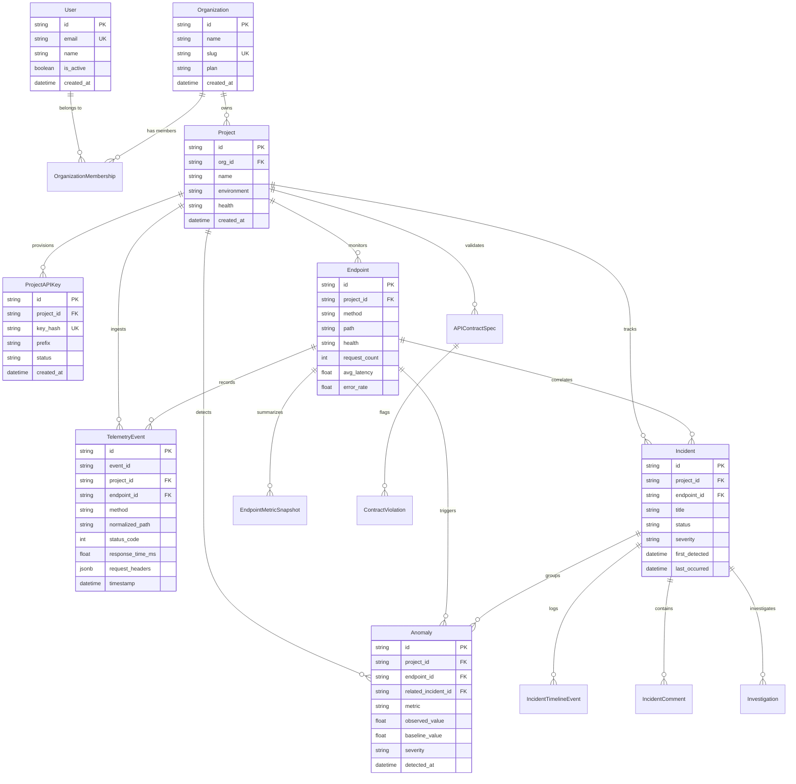

# Database Architecture & Schema Specification — CrimsonPulse AI

**Platform:** CrimsonPulse AI — AI-Powered API Intelligence & Incident Management Platform  
**RDBMS:** PostgreSQL 16 (Neon Serverless)  
**ORM / Driver:** Django 5.1 ORM with `psycopg 3`  
**Connection Pooler:** Built-in PgBouncer (Neon Pooler)  

---

## 1. Architectural Overview & Design Principles

CrimsonPulse AI is an enterprise observability SaaS platform that ingests, aggregates, and detects anomalies in high-throughput API telemetry streams.

The database architecture is designed with the following core principles:
1. **Multi-Tenant Isolation:** Complete logical isolation across Organizations and Projects using foreign key scoping and indexed tenant keys.
2. **Telemetry Idempotency:** Strict duplicate rejection at the database engine level via composite uniqueness constraints on `(project_id, event_id)`.
3. **High-Write Throughput:** Append-mostly design for `TelemetryEvent` records with targeted composite B-Tree indexes optimized for time-windowed querying.
4. **Serverless Scalability:** Zero-overhead connection management compatible with Neon's autoscaling and scale-to-zero compute architecture.

---

## 2. Entity-Relationship Diagram (ERD)

---

## 3. Core Database Tables & Constraints

### 3.1 `cp_telemetry_events`
Stores individual request telemetry points captured by the CrimsonPulse SDK.

| Column | Type | Constraints / Modifiers | Description |
| :--- | :--- | :--- | :--- |
| `id` | `VARCHAR(64)` | `PRIMARY KEY` | Unique ULID/hex telemetry identifier (`tel_...`). |
| `event_id` | `VARCHAR(128)` | `INDEX` | SDK-provided idempotency key or deterministic fingerprint. |
| `project_id` | `VARCHAR(64)` | `FOREIGN KEY (cp_projects.id) ON DELETE CASCADE` | Scopes telemetry to a tenant project. |
| `endpoint_id` | `VARCHAR(64)` | `FOREIGN KEY (cp_endpoints.id) ON DELETE SET NULL, NULLABLE` | Discovered endpoint correlation. |
| `raw_path` | `VARCHAR(512)` | `NOT NULL` | Original HTTP request URI. |
| `normalized_path` | `VARCHAR(512)` | `INDEX` | Parameter-stripped route template (e.g., `/api/orders/{id}/`). |
| `method` | `VARCHAR(16)` | `NOT NULL` | HTTP verb (`GET`, `POST`, `PUT`, `DELETE`, etc.). |
| `status_code` | `INTEGER` | `INDEX` | Response status code (`200`, `404`, `500`, etc.). |
| `response_time_ms`| `FLOAT` | `INDEX` | Nanosecond-resolution execution duration in milliseconds. |
| `environment` | `VARCHAR(32)` | `DEFAULT 'production'` | Deployment environment (`production`, `staging`, `dev`). |
| `app_version` | `VARCHAR(64)` | `DEFAULT ''` | Client application version string. |
| `error_message` | `TEXT` | `DEFAULT ''` | Sanitized exception or error string. |
| `error_type` | `VARCHAR(255)`| `DEFAULT ''` | Sanitized exception class name. |
| `error_stack` | `TEXT` | `DEFAULT ''` | Sanitized traceback. |
| `client_ip` | `INET` | `NULLABLE` | Anonymized client IP address. |
| `user_agent` | `TEXT` | `DEFAULT ''` | HTTP User-Agent header. |
| `request_headers` | `JSONB` | `DEFAULT '{}'::jsonb` | Sanitized header payload (Authorization/Cookie stripped). |
| `request_query` | `TEXT` | `DEFAULT ''` | Scrubbed query parameters (`token=[REDACTED]`). |
| `timestamp` | `TIMESTAMPTZ` | `INDEX` | Wall-clock time the request occurred. |
| `created_at` | `TIMESTAMPTZ` | `DEFAULT NOW()` | Record ingestion time. |

#### Constraints & Indexes
- **Unique Constraint:** `CONSTRAINT unique_project_event_id UNIQUE (project_id, event_id)`  
  *Guarantees idempotency at the database level. Duplicate SDK retries are rejected without incrementing counters.*
- **Composite Index 1:** `CREATE INDEX idx_tel_proj_ts ON cp_telemetry_events (project_id, timestamp DESC);`
- **Composite Index 2:** `CREATE INDEX idx_tel_ep_ts ON cp_telemetry_events (endpoint_id, timestamp DESC);`
- **Composite Index 3:** `CREATE INDEX idx_tel_status_ts ON cp_telemetry_events (status_code, timestamp DESC);`

---

### 3.2 `cp_endpoints`
Represents discovered API routes monitored by CrimsonPulse.

| Column | Type | Constraints | Description |
| :--- | :--- | :--- | :--- |
| `id` | `VARCHAR(64)` | `PRIMARY KEY` | Endpoint identifier (`ep_...`). |
| `project_id` | `VARCHAR(64)` | `FOREIGN KEY (cp_projects.id) ON DELETE CASCADE` | Scopes endpoint to project. |
| `method` | `VARCHAR(16)` | `NOT NULL` | HTTP method. |
| `path` | `VARCHAR(512)`| `NOT NULL` | Normalized route path. |
| `health` | `VARCHAR(32)` | `DEFAULT 'healthy'` | Calculated health state (`healthy`, `degraded`, `critical`). |
| `request_count` | `INTEGER` | `DEFAULT 0` | Total accepted request count. |
| `status_2xx` | `INTEGER` | `DEFAULT 0` | 2xx success count. |
| `status_3xx` | `INTEGER` | `DEFAULT 0` | 3xx redirect count. |
| `status_4xx` | `INTEGER` | `DEFAULT 0` | 4xx client error count. |
| `status_5xx` | `INTEGER` | `DEFAULT 0` | 5xx server error count. |
| `avg_latency` | `FLOAT` | `DEFAULT 0.0` | Running average latency in ms. |
| `p50_latency` | `FLOAT` | `DEFAULT 0.0` | Median response time in ms. |
| `p95_latency` | `FLOAT` | `DEFAULT 0.0` | 95th percentile response time. |
| `p99_latency` | `FLOAT` | `DEFAULT 0.0` | 99th percentile response time. |
| `error_rate` | `FLOAT` | `DEFAULT 0.0` | Calculated error percentage. |
| `last_activity` | `TIMESTAMPTZ` | `NULLABLE` | Timestamp of most recent telemetry event. |

#### Constraints & Indexes
- **Unique Constraint:** `CONSTRAINT unique_project_endpoint UNIQUE (project_id, method, path)`  
  *Prevents duplicate endpoint entries across identical routes.*

---

### 3.3 `cp_project_api_keys`
Secures telemetry ingestion from external client SDKs.

| Column | Type | Constraints | Description |
| :--- | :--- | :--- | :--- |
| `id` | `VARCHAR(64)` | `PRIMARY KEY` | API Key entity ID (`key_...`). |
| `project_id` | `VARCHAR(64)` | `FOREIGN KEY` | Project owner. |
| `name` | `VARCHAR(128)` | `DEFAULT 'Default Key'` | Human-readable key label. |
| `key_hash` | `VARCHAR(128)` | `UNIQUE, INDEX` | One-way SHA-256 hash of the full API key. |
| `prefix` | `VARCHAR(16)` | `INDEX` | Public key prefix (e.g. `cpk_live_abcd`). |
| `status` | `VARCHAR(32)` | `DEFAULT 'active'` | State (`active`, `revoked`, `expired`). |
| `created_at` | `TIMESTAMPTZ` | `DEFAULT NOW()` | Key creation timestamp. |

---

## 4. Neon Serverless Optimization & Connection Management

### 4.1 Avoiding Double Pooling
When connecting Django to Neon's PgBouncer pooler (`-pooler` in hostname):
- **Neon's PgBouncer** maintains a pool of warm connections to the underlying PostgreSQL compute instance.
- **Django's Connection Lifecycle:** If Django maintains persistent connections (`CONN_MAX_AGE > 0`), it holds client sockets open to PgBouncer indefinitely. This leads to connection starvation in serverless environments.
- **Solution:** CrimsonPulse sets `CONN_MAX_AGE = 0` when connecting via the pooled URL. Django opens a socket to PgBouncer for the duration of the request, executes queries, and closes it immediately. PgBouncer keeps the backend PostgreSQL connection alive, achieving sub-millisecond connection reuse without socket exhaustion.

### 4.2 Handling Serverless Auto-Suspend (Scale to Zero)
Neon compute nodes automatically suspend after an idle period (e.g. 5 minutes). When a query arrives:
1. Neon's proxy automatically wakes the compute node in ~500ms to 1s.
2. Django's `CONN_HEALTH_CHECKS = True` verifies that any pooled connection socket is alive before issuing application SQL.
3. If the socket was terminated during auto-suspend, Django gracefully reconnects without raising an unhandled exception to the user.

